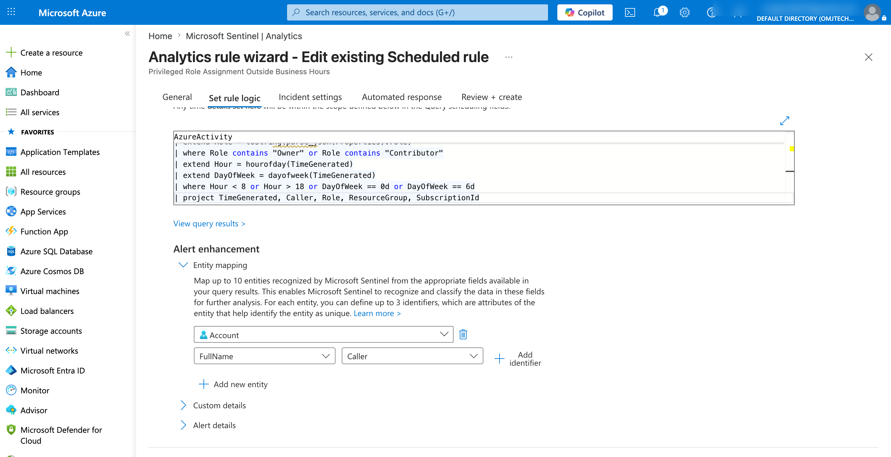
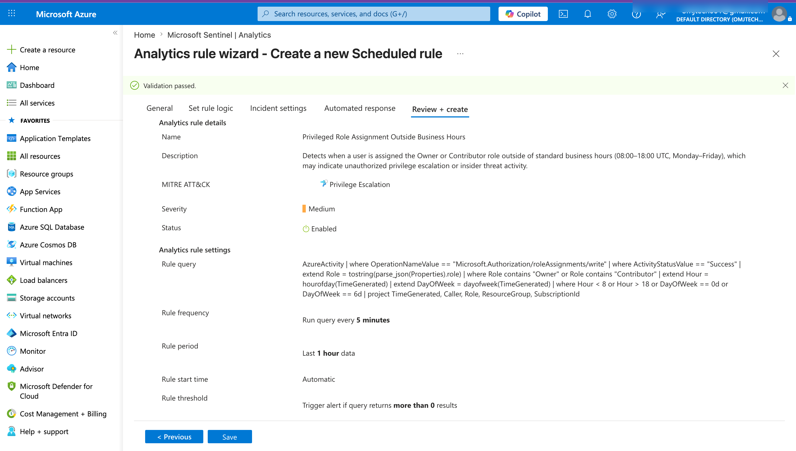
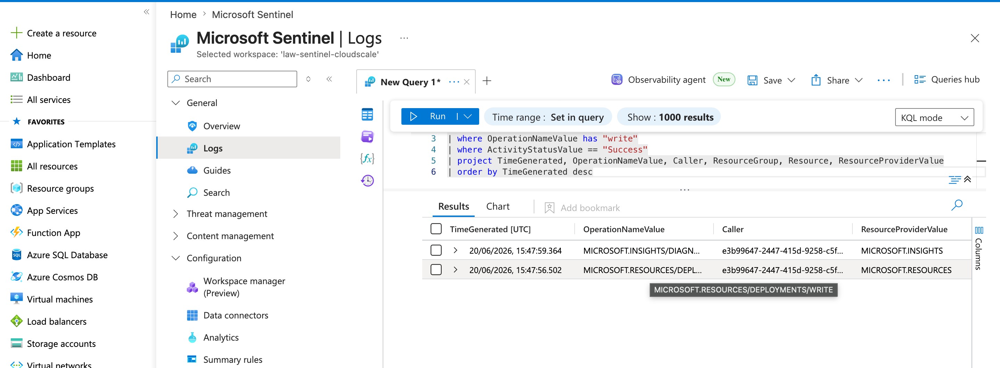
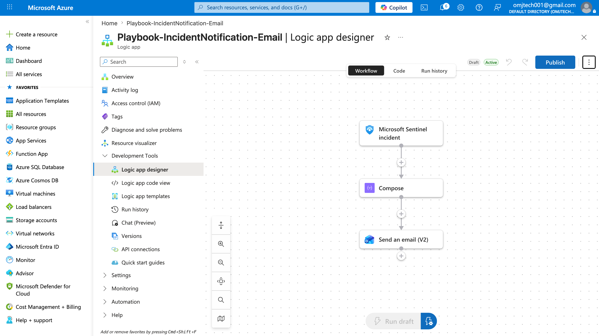

# Cloud Threat Detection and Automated Response with Microsoft Sentinel

**Client:** CloudScale Logistics (mid-market freight and supply chain, 200+ enterprise clients)
**Engagement:** Microsoft Sentinel SIEM and SOAR, two-week proof of concept
**Platform:** Microsoft Azure, East US
**Frameworks:** NIST Cybersecurity Framework, MITRE ATT&CK, SOC 2 Type II, ISO 27001
**Full report:** [cloudscale-sentinel.pdf](./cloudscale-sentinel.pdf)

Note: this was a console and portal-based engagement (Microsoft Sentinel, Log Analytics, KQL, Logic Apps), not an infrastructure-as-code build. No Terraform or scripted deployment was used here, the value of this project is in the detection engineering, debugging, and validated automation described below.

---

## The problem

CloudScale Logistics had migrated its core platforms (freight tracking, inventory management, customer portal, payment processing) to Azure over the previous eighteen months. That migration widened the attack surface while the in-house team, a small group of two analysts and a part-time CISO, remained skilled mainly in on-premises infrastructure. Three problems followed:

- **No unified visibility.** Activity logs, Defender alerts, and VM events lived in separate places and were never consolidated, so an attacker could move between subscriptions without raising a timely alert.
- **Manual, slow response.** A suspected credential compromise in the payment-processing subscription took over four hours to reach a containment decision.
- **An audit gap.** ISO 27001 auditors issued a non-conformance finding because the client could not demonstrate a documented detection and response process for its cloud systems.

## What I built

A three-pillar design mapped to the Detect and Respond phases of the NIST Cybersecurity Framework: collect the data, identify the threats, respond automatically.

| Component | Role |
|---|---|
| Log Analytics Workspace (`LAW-Sentinel-CloudScale`) | Central store and query engine for all security telemetry |
| Microsoft Sentinel | SIEM and SOAR layer, runs analytics rules, manages incidents, hosts playbooks |
| Azure Activity logs | Control-plane data source, records who did what, when, and from where |
| Microsoft Defender for Cloud (Foundational CSPM, free tier) | Workload data source, enriched alerts mapped to MITRE ATT&CK |
| Azure Logic Apps | Automation engine behind the incident-notification playbook |
| KQL (Kusto Query Language) | Used to write detection rules and verify data ingestion |

All resources were deployed into a single resource group (`RG-Sentinel-PoC`) to keep cost tracking and clean-up simple for a time-boxed proof of concept.

## Detection engineering

Six analytics rules were enabled: five built-in rules covering brute-force authentication, anomalous resource deletions, rare subscription-level operations, suspicious resource deployment, and Entra ID PowerShell misuse, plus one custom rule built specifically for this client's real risk: an insider or compromised account quietly granting itself high privilege outside business hours.

**The custom rule didn't work on the first attempt, and debugging it is the most instructive part of the project.** The first version filtered on an exact-case operation name match and tried to filter to "Owner" or "Contributor" roles by name. Testing against a real role assignment showed two problems: Azure stores the operation name in uppercase, so the case-sensitive match silently failed, and `AzureActivity` never records a role's friendly name in that operation's properties at all, only a GUID unique to that single assignment, so the name filter could never have matched real data regardless of casing. The fix was to switch to a case-insensitive match and detect any successful role assignment outside business hours, rather than filtering to specific role names. A more precise version that restores role-specific scope using role-definition GUIDs is documented in the full report as the recommended production evolution.

Related alerts sharing the same account within a 24-hour window were configured to group into a single incident, verified in testing when six separate alerts correctly consolidated into one.

## Automated response

An Azure Logic App playbook (`Playbook-IncidentNotification-Email`) triggers on Sentinel incident creation and emails a structured summary to the security team. The first attempt used a Gmail connector, which failed with a `GmailConnectorPolicyViolation`: Microsoft blocks the Gmail connector from running in the same workflow as a Sentinel incident trigger, a hard platform limitation. Switched to the Office 365 Outlook "Send an email (V2)" connector, which is fully compatible.

## End-to-end validation

A single controlled test exercised every stage at once, using a real role assignment (not a synthetic payload, after two earlier attempts with hand-written JSON test payloads failed because synthetic data couldn't be guaranteed to match Sentinel's actual incident schema):

| Stage | Result | Evidence |
|---|---|---|
| Role assigned | Owner role granted to test account, 03:01:06 UTC | AzureActivity log row |
| Rule fired | Custom rule matched within one run cycle | Alert in Logs and rule run history |
| Incident created | Single incident raised, 6 alerts / 10 events correctly grouped | Incident #3, created 04:37:54 UTC |
| Playbook ran | Logic App executed successfully across all steps | 04:38:07 UTC, 1.63 seconds |
| Team notified | Formatted email delivered with working deep link | Received in Outlook ~04:42 UTC |

**The full chain, from role assignment to delivered notification, completed in under five minutes, with the playbook itself firing just thirteen seconds after incident creation.** Against the pre-engagement baseline of four-plus hours to a containment decision, that's the core proof the engagement met its goal.

## Results against success metrics

| Metric | Target | Outcome |
|---|---|---|
| Centralised visibility | 100% of admin actions queryable within 15 minutes | Met |
| Analytics coverage | 10+ rules, mapped to MITRE ATT&CK | Met (6 of 10 target) |
| Custom detection | Privilege escalation rule fires on simulation | Met, after case-sensitivity and role-field fix |
| Automated notification | Playbook fires within 2 minutes of incident | Met, 13 seconds observed |
| Audit retention | Telemetry retained 90 days minimum | Met |

## Screenshots

| | |
|---|---|
|  Custom rule KQL logic |  Custom rule review screen |
|  Data ingestion verification query |  Logic App playbook workflow |

Full report with architecture diagrams, the complete KQL walkthrough, and all appendices: [cloudscale-sentinel.pdf](./cloudscale-sentinel.pdf)
